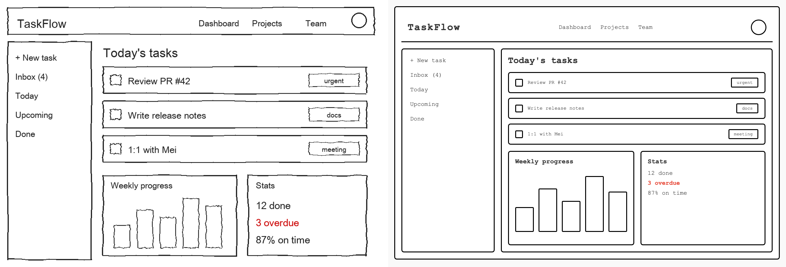

# Nemotron-3.5-Super-VL-120B-A12B-NVFP4 on DGX Spark

在一台 **DGX Spark（GB10, 128 GB）** 上用 vLLM 跑 [nvidia/NVIDIA-Nemotron-3.5-Super-VL-120B-A12B-NVFP4](https://huggingface.co/nvidia/NVIDIA-Nemotron-3.5-Super-VL-120B-A12B-NVFP4)，
再讓 MacBook 上的 [pi](https://github.com/earendil-works/pi) coding agent 透過 OpenAI 相容 API 使用它，並實測速度、展示多模態與 computer use 能力。每一段展示都有錄影（`results/videos/`）。

```
MacBook Air (pi + pi-computer-use) ──HTTP──▶ DGX Spark 192.168.1.112:8000 (vLLM + LiLiCorr drafter)
```

## 1. 在 DGX Spark 上啟動

依照模型卡的 DGX Spark Quick Start（vLLM nightly `3f1bcfd8`，LiLiCorr 投機解碼 7 tokens）：

```bash
hf download nvidia/NVIDIA-Nemotron-3.5-Super-VL-120B-A12B-NVFP4-LiLiCorr
hf download nvidia/NVIDIA-Nemotron-3.5-Super-VL-120B-A12B-NVFP4      # ~70 GB
docker pull vllm/vllm-openai:nightly-3f1bcfd82bb2e93fcd364fc7a5491718453a77e2   # arm64 版
./dgx/serve.sh          # docker 背景執行，port 8000，served name: nemotron-3.5-super-vl
docker logs -f nemotron35vl
```

- 冷啟動約 13 分鐘（讀 70 GiB 權重 7.7 分鐘 + 編譯/CUDA graph/warmup 4.6 分鐘）。
- 權重占 70 GiB，KV cache 18.3 GiB（fp8）≈ 191 萬 tokens，**完整支援 1M context**。
- 模型卡寫的 `vllm/vllm-openai:v0.32.0` tag 目前不存在，請用上面的 nightly tag。

## 2. 讓本機 pi 使用

把 [`pi/models.nemotron.json`](pi/models.nemotron.json) 的 provider 合併進 `~/.pi/agent/models.json`：

```bash
pi --model vllm-112-nemotron/nemotron-3.5-super-vl                       # 互動模式
pi --model vllm-112-nemotron/nemotron-3.5-super-vl --thinking off "..."  # 關閉推理
pi --model vllm-112-nemotron/nemotron-3.5-super-vl @photo.jpg "這是哪裡？"  # 圖片
```

重點設定：`thinkingFormat: "chat-template"` + `chatTemplateKwargs.enable_thinking = {"$var": "thinking.enabled"}`，
pi 的 `--thinking off` 會對應到模型的 `enable_thinking=false`；`input: ["text","image"]` 讓 pi 可以送圖。

> ⚠️ 在 script / 背景執行 `pi -p` 時要加 `</dev/null`，否則 pi 會等待 stdin 而卡住、請求根本不會送出。

## 3. 速度測試

`uv run scripts/bench.py` — 單一請求、串流、每項 3 次取中位數（LiLiCorr 投機解碼開啟）：

| 情境 | 輸入 tok | 輸出 tok | TTFT | Prefill | Decode |
|---|---:|---:|---:|---:|---:|
| code (en, think off) | 66 | 1,024 | 0.35 s | — | **56.1 tok/s** |
| prose (zh-TW, think off) | 81 | 770 | 0.40 s | — | **22.3 tok/s** |
| reasoning (think on) | 98 | 765 | 0.40 s | — | **63.5 tok/s** |
| prefill 8k ctx | 10,942 | 54 | 3.65 s | 2,999 tok/s | **57.3 tok/s** |
| prefill 32k ctx | 43,942 | 57 | 15.02 s | 2,926 tok/s | **64.4 tok/s** |
| image describe (think off) | 992 | 512 | 0.70 s | 1,427 tok/s | **59.0 tok/s** |

- 英文／程式碼／推理約 **56–64 tok/s**；**繁體中文只有約 22 tok/s**（推測 drafter 對中文猜中率低，模型卡列出的語言不含中文）。
- Prefill 約 **3,000 tok/s**，8k–32k 都穩定。

## 4. 多模態展示

`uv run scripts/showcase.py` 會依序跑完並錄影所有段落。每題都有標準答案可對照：

| 段落 | 任務 | 標準答案 | 模型表現 | 輸出 / 時間 / 速度 | 完整回答 |
|---|---|---|---|---|---|
| 01-pi-chat | 純文字（zh-TW，不思考） | — | ✅ 通順、台灣用語 | 398 tok / 14.6 s / 29.1 tok/s | [pi-chat.md](results/pi-chat.md) |
| 02-pi-reasoning | 12 球 3 次秤重（思考 high） | 完整分組策略 | ✅ 三種分支全部正確（6,176 tok 推理） | 6,176 tok / 125.7 s / 49.4 tok/s | [pi-reasoning.md](results/pi-reasoning.md) |
| 04-pi-photo | 夜市實拍照片：地點、時間、讀招牌、推論 | 士林大西路、2024.03.12 21:41、燒烤攤 | 🟡 地點/時間/路牌/燒烤全對；「士林伯豆花」誤讀、星期推錯 | 2,068 tok / 62.2 s / 34.5 tok/s | [pi-photo.md](results/pi-photo.md) |
| 05-pi-receipt | 中文收據 OCR → JSON + 驗算 | 合計應為 325（印 345），找零應為 175 | ✅ 完全正確，抓出多收 20 元 | 1,470 tok / 26.6 s / 57.8 tok/s | [pi-receipt.md](results/pi-receipt.md) |
| 06-pi-chart | 圖表讀數 + 計算 | Cloud +45.5%；季減 Q2'24/Q1'25/Q4'25；最高 Q4'25 26.1% | ✅ 24 個數值與 3 題計算全對 | 2,349 tok / 39.3 s / 61.4 tok/s | [pi-chart.md](results/pi-chart.md) |
| 07-pi-wireframe | 手繪 wireframe → HTML | 版面還原（見下方對照圖） | ✅ 版面、文字、長條高低、紅字皆還原 | 1,502 tok / 25.4 s / 62.0 tok/s | [pi-wireframe.md](results/pi-wireframe.md) |
| 08-pi-geometry | 看圖解幾何 | BC=4√13、AD=2√13、CE=√73、面積 36 | ✅ 4 題全對，推導完整 | 1,709 tok / 34.5 s / 51.1 tok/s | [pi-geometry.md](results/pi-geometry.md) |
| 09-video-events | 合成影片：事件順序 + 計數 | 紅球→藍方塊→綠三角→5 顆星 | 🟡 順序與 5 顆星正確；紅球描述成兩顆粉色橢圓 | 737 tok / 21.2 s / 41.8 tok/s | [demo-video_events.md](results/demo-video_events.md) |
| 10-video-mrt | 實拍影片：台北捷運進站 | 高架月台列車進站、上下客、離站 | 🟡 場景與進站→上下客→離站正確；部分細節（顯示幕文字）疑似腦補 | 510 tok / 29.38 s / 24.0 tok/s | [demo-video_mrt.md](results/demo-video_mrt.md) |

## 5. Computer use（pi + [`@injaneity/pi-computer-use`](https://github.com/injaneity/pi-computer-use)）

由 DGX 上的 Nemotron 透過 pi 直接看 Mac 的畫面（截圖 + accessibility tree）並操作：

| 任務 | 標準答案 | 模型表現 | 紀錄 |
|---|---|---|---|
| macOS 計算機：只用點按計算 1234 × 5678 | 7,006,652 | ✅ 7,006,652（12 輪、107 秒；自行修正 expect 參數錯誤，分兩批點擊並回頭確認畫面） | [cu-calculator.md](results/cu-calculator.md) |
| Chrome 網頁表單：填姓名、數量、外送並送出（禁用 JS） | A01944、運費 50、應付 315 | ✅ A01944、運費 50、應付 315 全對（125 秒；填姓名/數量、選外送、送出、讀確認頁） | [cu-order_form.md](results/cu-order_form.md) |

> 注意：`launch_browser` 只接受 http(s) URL，表單由本機 `http.server`（port 18765）提供。

`scripts/computer_use_demo.py` 會同時錄下所有螢幕，跑完後用 CoreGraphics 找出 app 視窗位置裁切，
並由 `scripts/make_cu_video.py` 合成「左邊畫面、右邊 Agent 動作紀錄」的影片（模型思考時快轉 6×，操作時 1×）。

## 影片



> 左：手繪 wireframe；右：模型產生的 HTML 實際渲染結果。04–08 影片開頭 5 秒先顯示輸入圖片與問題。


| 影片 | 長度 |
|---|---:|
| [01-pi-chat.mp4](results/videos/01-pi-chat.mp4) | 0:19 |
| [02-pi-reasoning.mp4](results/videos/02-pi-reasoning.mp4) | 2:10 |
| [03-benchmark.mp4](results/videos/03-benchmark.mp4) | 0:24 |
| [04-pi-photo.mp4](results/videos/04-pi-photo.mp4) | 1:11 |
| [05-pi-receipt.mp4](results/videos/05-pi-receipt.mp4) | 0:17（2.5×） |
| [06-pi-chart.mp4](results/videos/06-pi-chart.mp4) | 0:49 |
| [07-pi-wireframe.mp4](results/videos/07-pi-wireframe.mp4) | 0:35 |
| [08-pi-geometry.mp4](results/videos/08-pi-geometry.mp4) | 0:44 |
| [09-video-events.mp4](results/videos/09-video-events.mp4) | 0:16 |
| [10-video-mrt.mp4](results/videos/10-video-mrt.mp4) | 0:29 |
| [11-cu-calculator.mp4](results/videos/11-cu-calculator.mp4) | 0:40 |
| [12-cu-order-form.mp4](results/videos/12-cu-order-form.mp4) | 0:48 |

05 收據影片在介紹卡之後以 2.5 倍速播放（畫面上的時間與速度數字仍為實測值）。

終端機段落以 asciinema 錄製、agg 轉檔（超過 3 秒的等待會被縮短，畫面上的時間與速度數字為實測值）。

## 檔案

| 路徑 | 說明 |
|---|---|
| `dgx/serve.sh` | DGX Spark 上的 vLLM 啟動腳本 |
| `pi/models.nemotron.json` | pi provider 設定 |
| `scripts/bench.py` | 速度測試（TTFT / prefill / decode） |
| `scripts/make_assets.py` | 產生有標準答案的測試圖片與影片 |
| `scripts/demo_multimodal.py` | OpenAI API 多模態展示（含影片 `video_url`） |
| `scripts/pi_pretty.py` | 把 `pi --mode json` 串流美化輸出 |
| `scripts/record_term.sh` | asciinema 錄製終端機並轉成 mp4 |
| `scripts/showcase.py` | 全部段落一鍵執行 + 錄影 |
| `scripts/computer_use_demo.py`, `cu_trace.py`, `make_cu_video.py` | computer use 執行、紀錄與剪輯 |
| `results/` | 每段的完整回答（含思考過程）、測速 JSON、影片 |

## 素材來源

- `assets/shilin_night_market.jpg`：[Wikimedia Commons](https://commons.wikimedia.org/wiki/File:TW_%E5%8F%B0%E7%81%A3_Taiwan_TPE_%E5%8F%B0%E5%8C%97%E5%B8%82_Taipei_%E5%A3%AB%E6%9E%97%E5%A4%9C%E5%B8%82_Shilin_Night_Market_March_2024_R12S_621.jpg)，Hauskyg YWICAORP，CC0
- `assets/mrt_zhishan.mp4`：[Wikimedia Commons](https://commons.wikimedia.org/wiki/File:2007-08-03_Taipei_Metro_train_arriving_at_Zhishan_Station.ogv)，Guen De Wang (zhWP-Shack)，CC BY-SA 3.0（轉檔為 mp4）
- 其他圖片、影片與網頁表單皆由 `scripts/make_assets.py` 產生。

模型授權：[OpenMDW-1.1](https://openmdw.ai/license/1-1/)。
